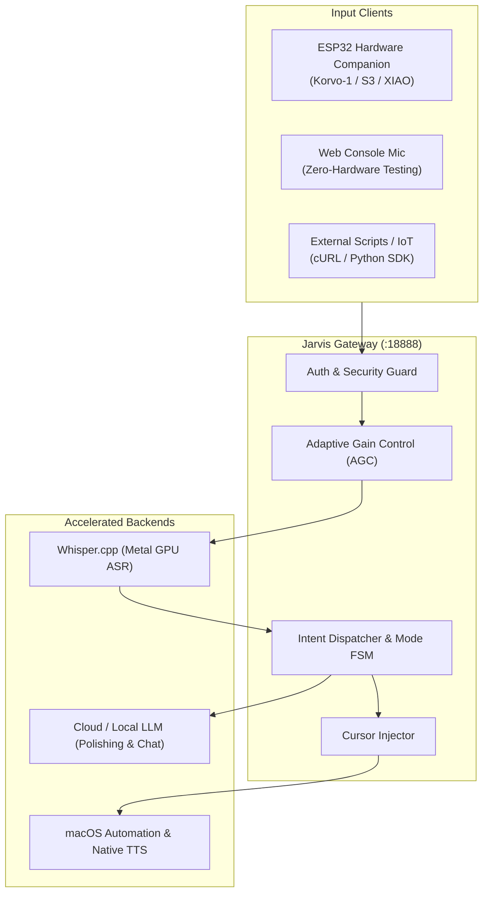

# Jarvis Gateway

[](LICENSE)
[](pyproject.toml)
[]()
[](CONTRIBUTING.md)

**English** | [简体中文](./README_zh.md)

Turn your Mac into the ultimate local AI brain for hardware companions (ESP32, smart microphones, Raspberry Pi, and beyond): **offline low-latency speech-to-text (Whisper Metal), AI text polishing, direct cursor typing injection, and voice system automation.**

Audio is processed locally and never uploaded; only text is sent to the LLM you configure (if any).

---

## Highlights

- 🎙️ **Fast Offline ASR**: Apple Silicon Metal acceleration powered by `whisper.cpp`; typical utterances transcribe in well under a second (varies with audio length and hardware).
- ⌨️ **Direct Cursor Injection**: Types polished text into whichever application has focus (VS Code, Slack, Obsidian, WeChat, etc.), with clipboard backup and restore.
- 🧠 **Dual-Channel LLM Polishing**: Removes filler words ("um", "ah", stuttering), corrects homophones, and formats punctuation with automatic fallback.
- ⚡ **Zero-Hardware Browser Mic Testing**: Don't have an ESP32 yet? Simply open the web console and hold Spacebar to talk through your laptop mic and test instant typing!
- 🧠 **Long-Term Memory & Self-Evolution**: Dialog mode recalls recent turns and learned facts offline (no embeddings), and periodically distills the conversation into durable facts plus a persona summary.
- 🎛️ **Web Console & macOS Menubar App**: Monitor services, switch modes, view token estimates and latency in real time.
- 🔒 **Security First**: No `shell=True` execution, strict command whitelisting, and optional Bearer/Header token authentication for shared LANs.

---

## 30-Second Quickstart (No Hardware Required!)

### 1. Clone and Install

```bash
git clone https://github.com/peyoba/jarvis-gateway.git
cd jarvis-gateway
python3 -m venv venv
source venv/bin/activate
pip install -e .
```

### 2. Install Local Whisper (Recommended for Apple Silicon)

```bash
brew install whisper.cpp
mkdir -p ~/.cache/whisper
curl -L -o ~/.cache/whisper/ggml-small-q5_1.bin \
  https://huggingface.co/ggerganov/whisper.cpp/resolve/main/ggml-small-q5_1.bin
```

### 3. Configure Your LLM (for Polishing and Chat)

```bash
cp config.example.json config.json
```
Edit `config.json` with any OpenAI-compatible API key (OpenAI, DeepSeek, Qwen, Ollama, etc.).

### 4. Start the Gateway

```bash
./jarvis start --open
```
The browser console will open at `http://127.0.0.1:18888/`.
**Hold the "Hold to Talk" button (or hold the Spacebar)**, speak into your Mac microphone, and release—watch the text type right into your active text editor!

> The browser records raw 16 kHz mono PCM (no WebM/Opus), so it exercises the exact same path as the ESP32.

### 5. Optional: expose the gateway to your LAN

For safety the gateway binds `127.0.0.1` only and the legacy `:8080` data port is off. To let an ESP32 or phone connect:

```jsonc
// config.json
{
  "gateway": {
    "host": "0.0.0.0",
    "port": 18888,
    "auth_token": "${JARVIS_AUTH_TOKEN}",
    "allowed_hosts": ["jarvis.local"],
    "enable_legacy_data_port": false
  }
}
```

```bash
export JARVIS_AUTH_TOKEN="$(openssl rand -hex 24)"
./jarvis restart
```

`${VAR}` placeholders in `gateway.auth_token` are expanded from the environment at startup, so secrets never need to be committed. A referenced token variable that is missing or empty is a startup error (the gateway never silently disables authentication). The same non-empty token can be exported as `JARVIS_AUTH_TOKEN` to override `config.json`; launchd/Finder environments must define it separately. Use a random visible-ASCII token without whitespace. Non-loopback listeners without a token are rejected.

Clients must then send `Authorization: Bearer <token>` (or `X-Jarvis-Token: <token>`) on write requests and full `/status`. **The stock ESP32 firmware does not send this header**, so update the sketch before enabling auth. `/ping`, `/status?summary=1` (metadata only), and `/mode?simple=1` stay open for board/App health checks; full `/status` requires the token because it includes recent dictation text.

Mode changes use `POST /mode?set=raw` or `POST /toggle-mode`. Legacy GET mutations return 405; update firmware that still uses them. Overlapping audio requests return 429 instead of typing results out of order. Browser recording stops at 60 seconds; decoded uploads are capped at 120 seconds / 8 MiB per request.

> Configuration precedence is `--config PATH` > `JARVIS_CONFIG` > project `config.json` > standard locations. For example, use `./jarvis --config /path/to/config.json start`; the selected path is also passed to the gateway and LaunchAgent. `Jarvis.app` uses the same explicit/environment precedence. Finder/launchd environments must be configured separately—secrets are never copied into the plist.
>
> After editing configuration, restart when convenient. `./jarvis stop` can still stop identity-verified, launcher-managed processes if configuration is invalid or their ports changed; unknown processes are preserved and reported. Starting with changed ports cannot overwrite a still-running managed process record.

### 6. Optional: push the gateway address to the board

The firmware stores the gateway address in NVS (`hatch.host`); when your Mac's LAN address changes, the board silently loses the gateway. With the board attached over USB you can rewrite it:

```bash
./jarvis ip-sync                  # write the current LAN address (skips when unchanged)
./jarvis ip-sync --ip 192.168.0.102 --port /dev/cu.usbserial-10
./jarvis ip-guard start           # optional: background daemon that rewrites on change
```

The 开发板地址 panel on the dashboard exposes the same two actions (**同步到开发板** skips the serial write when the address already matches, **写入指定地址** takes a typed address), so any phone or laptop on the same Wi-Fi can fix the board. Requires `pyserial` (`venv/bin/pip install pyserial`, or `pip install 'jarvis-gateway[serial]'`). Opening the serial port resets the board for a few seconds, so a write only happens when the address actually changed; see [the sync guide (Chinese)](docs/开发板网关地址自动同步.md) for details.

### 7. Optional: control the service from the browser console

The dashboard (`http://<mac-ip>:18888/`) is one page in a warm-sand light theme: a hero card with the current-mode orb, three KPI tiles and the four-mode segmented switcher; three service-health cards (gateway / Whisper / token+weather); the **服务控制** (Service Control) panel; the **开发板链路** (board address) panel; the recent-turns table; a collapsible read-only log tail; and two repository-only cards for the browser microphone and the access token. It polls `GET /status` every 3 s, `GET /board` every 4 s and `GET /service` every 5 s, and only fetches logs when you expand the panel.

Everything the menu-bar app can do is also on the 服务控制 panel, so the same commands work from a phone or another laptop: start / restart / stop, the login-autostart toggle, "open log folder", "open Accessibility settings", and a live tail of the gateway / whisper / ip_guard / autostart / control logs. The hero line mirrors the menu-bar tooltip (`网关运行中 · 识别就绪 · 数据在线 · 模式 分流`); clicking a mode button sends `POST /mode` with a JSON body, and the board's screen label follows within about two seconds.

Both entries stay usable at the same time; the panel is a duplicate, not a replacement. `POST /service` is asynchronous (202 + `busy` 409 while an action runs) and `GET /logs?name=…&lines=120` is read-only. **Stopping or restarting kills the process that serves this page**, so both ask for confirmation first, and after a stop the page cannot start it again — use `./jarvis start` or the menu bar. Turning autostart off only removes the LaunchAgent and disables the label; it never `unload`s the job that is serving you.

Two extra cards only exist in this repository build: **网页麦克风** records from the browser (hold the button or the space bar, up to 60 s) and posts 16 kHz / 16-bit mono PCM to `POST /chat`; **访问令牌** stores the `gateway.auth_token` in that browser's `localStorage`, and any request that comes back 401 prompts once and retries. Mutating endpoints stay POST-only, and with a token configured every request needs it.

---

## Architecture Overview



---

## Four Input Modes

| Mode | Trigger | Behavior | Latency |
|---|---|---|---|
| **Auto `auto`** | Default | Short press (< 2.8s) -> raw typing; Long press (>= 2.8s) -> AI polished typing | Typically < 1.5s, varies |
| **Raw `raw`** | Dashboard / HTTP API | Types verbatim what is heard without cloud calls | Typically < 1s, varies |
| **Polish `polish`** | Dashboard / HTTP API | Cleans spoken disfluencies and fixes punctuation | ASR + LLM latency |
| **Dialog `dialog`** | Dashboard / HTTP API | Voice conversation + Mac system control (volume, music, apps, screen lock) | Depends on LLM |

Fast system commands (volume, music, lock screen, weather…) only run in `dialog` mode or when the utterance starts with the wake word `贾维斯`. Typing modes (`auto`/`raw`/`polish`) never hijack your dictation, so "turn the volume to fifty" can be typed verbatim instead of changing the volume.

Polishing skips texts of up to three characters. Missing/failed models safely fall back to raw typing; the console distinguishes AI-polished, short raw, and degraded raw results. `llm.total_timeout` (default 16 seconds) bounds the combined primary/fallback model operation and cancels its network I/O on expiry; ASR, typing and TTS have separate limits.

System control is reported as successful only after a zero-exit execution. Model usage prefers provider-reported tokens; missing usage is explicitly estimated, and zero model calls add zero tokens. Failed/timed-out calls may have unknown additional charges. Local usage is gateway-session data, not a full-account bill.

---

## Long-Term Memory (Dialog Mode)

\`dialog\` mode keeps context across utterances: the most recent exchanges are injected into every chat request, and durable facts are recalled with a dependency-free token-overlap scorer (no embeddings, no extra services).

- **Say it once**: "记住：我叫老王，喜欢美式咖啡" stores a fact and answers instantly from the local store — no model call.
- **Management commands**: "忘掉…", "你记住了什么", "整理记忆", "清空记忆".
- **Self-evolution**: every few dialog turns the gateway asks the model to distill the recent conversation into new facts and a short persona paragraph, which then shapes later replies. Consolidation runs off the reply path, so voice latency is unaffected.
- **Console card**: 「长期记忆」 shows fact count, context turns and consolidation count, plus a manual 「立即整理记忆」 button.
- **HTTP**: \`GET /memory?summary=1\` (public counters), \`GET /memory\` (full snapshot, authenticated), \`POST /memory\` with \`{"action": "consolidate" | "add" | "clear"}\`.
- **Storage**: \`~/.jarvis/memory\` (\`facts.json\`, \`persona.md\`, \`meta.json\`, \`history.jsonl\`), override with \`JARVIS_MEMORY_DIR\`; writes are atomic, files \`0600\` inside a \`0700\` directory. Config lives under the \`memory\` key.

---

## Hardware Companion Wire Protocol

Any IoT device capable of making HTTP POST requests can interface with Jarvis Gateway:

- **Endpoint**: `POST /chat?mode=auto`
- **Format**: 16kHz 16-bit Mono PCM or RIFF WAV binary payload
- **Response Format**:
  ```text
  +--------------------------------+--------------------------------+
  | 4-byte Big-Endian JSON Length  | JSON Metadata string (UTF-8)   |
  +--------------------------------+--------------------------------+
  | 16kHz 16-bit Mono PCM audio stream (max 120s; 100ms silence frame for typing)|
  +----------------------------------------------------------------+
  ```

Response metadata also includes `kind`/`error`, `action_results` (success, error and return code), `polish` (requested/applied/reason), and `llm_usage` (calls, total_tokens, estimated, incomplete). These are additive fields; the length-prefixed JSON + 16 kHz PCM framing is unchanged.

---

## Requirements & Permissions

1. **macOS Accessibility Permission**:
   To inject text into active text cursors using `Cmd+V`, macOS requires Accessibility permissions.
   Go to: **System Settings → Privacy & Security → Accessibility**, and enable your terminal emulator (`Terminal` or `iTerm`) and/or `Jarvis.app`.

2. **Network Security**:
   The gateway listens on `127.0.0.1:18888` by default. If you bind `0.0.0.0` for hardware access, `gateway.auth_token` is required; startup fails without it. Host headers are validated, and cross-site state-changing requests are rejected. LAN HTTP is not encrypted. Do not expose the port to the public internet—use a VPN or a correctly configured authenticated TLS proxy for remote access.

3. **Privacy and logs**:
   Audio is processed through temporary files only. Default logs contain byte counts, timings, statuses, and character counts—not dictation, model replies, or clipboard contents. New launcher-managed service logs use directory mode `0700`, files `0600`, and rotate at 5 MiB with two backups; old logs are not erased. Enable `JARVIS_HTTP_LOG` only for short, local debugging. Raw dictation stays local unless you explicitly say a command such as `润色：...`; polish/dialog modes send text to the configured LLM provider.

## Python package versus checkout

After installing a wheel, run `jarvis-gateway --config /path/to/config.json`. This starts the gateway only: run `whisper-server` separately or configure the CLI fallback. The menu-bar App and `./jarvis` launcher are checkout tools requiring macOS, the project files, and its Python environment. Building/installing a package does not restart an existing service.

---

## Running Tests

Jarvis Gateway includes a test suite covering audio conversion, wire protocol framing, command whitelisting, HTTP routing, authentication, Host validation, body limits, and hallucination filtering:

```bash
pip install -e ".[dev]"
pytest -q
ruff check src tests
```

---

## License

This project is licensed under the [MIT License](LICENSE).
