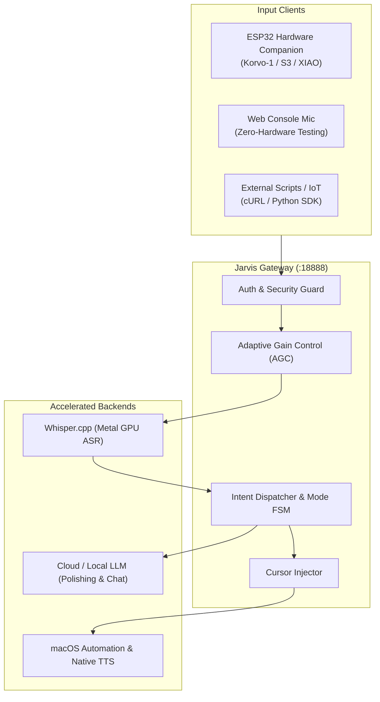

# Jarvis Gateway

[](LICENSE)
[](pyproject.toml)
[]()
[](CONTRIBUTING.md)

**English** | [简体中文](./README_zh.md)

Turn your Mac into the ultimate local AI brain for hardware companions (ESP32, smart microphones, Raspberry Pi, and beyond): **offline low-latency speech-to-text (Whisper Metal), AI text polishing, direct cursor typing injection, and voice system automation.**

Audio is processed locally and never uploaded; only text is sent to the LLM you configure (if any).

---

## Highlights

- 🎙️ **Fast Offline ASR**: Apple Silicon Metal acceleration powered by `whisper.cpp`; typical utterances transcribe in well under a second (varies with audio length and hardware).
- ⌨️ **Direct Cursor Injection**: Types polished text into whichever application has focus (VS Code, Slack, Obsidian, WeChat, etc.), with clipboard backup and restore.
- 🧠 **Dual-Channel LLM Polishing**: Removes filler words ("um", "ah", stuttering), corrects homophones, and formats punctuation with automatic fallback.
- ⚡ **Zero-Hardware Browser Mic Testing**: Don't have an ESP32 yet? Simply open the web console and hold Spacebar to talk through your laptop mic and test instant typing!
- 🎛️ **Web Console & macOS Menubar App**: Monitor services, switch modes, view token estimates and latency in real time.
- 🔒 **Security First**: No `shell=True` execution, strict command whitelisting, and optional Bearer/Header token authentication for shared LANs.

---

## 30-Second Quickstart (No Hardware Required!)

### 1. Clone and Install

```bash
git clone https://github.com/peyoba/jarvis-gateway.git
cd jarvis-gateway
python3 -m venv venv
source venv/bin/activate
pip install -e .
```

### 2. Install Local Whisper (Recommended for Apple Silicon)

```bash
brew install whisper.cpp
mkdir -p ~/.cache/whisper
curl -L -o ~/.cache/whisper/ggml-small-q5_1.bin \
  https://huggingface.co/ggerganov/whisper.cpp/resolve/main/ggml-small-q5_1.bin
```

### 3. Configure Your LLM (for Polishing and Chat)

```bash
cp config.example.json config.json
```
Edit `config.json` with any OpenAI-compatible API key (OpenAI, DeepSeek, Qwen, Ollama, etc.).

### 4. Start the Gateway

```bash
./jarvis start --open
```
The browser console will open at `http://127.0.0.1:18888/`.
**Hold the "Hold to Talk" button (or hold the Spacebar)**, speak into your Mac microphone, and release—watch the text type right into your active text editor!

> The browser records raw 16 kHz mono PCM (no WebM/Opus), so it exercises the exact same path as the ESP32.

### 5. Optional: expose the gateway to your LAN

For safety the gateway binds `127.0.0.1` only and the legacy `:8080` data port is off. To let an ESP32 or phone connect:

```jsonc
// config.json
{
  "gateway": {
    "host": "0.0.0.0",
    "port": 18888,
    "auth_token": "${JARVIS_AUTH_TOKEN}",
    "allowed_hosts": ["jarvis.local"],
    "enable_legacy_data_port": false
  }
}
```

```bash
export JARVIS_AUTH_TOKEN="$(openssl rand -hex 24)"
./jarvis restart
```

`${VAR}` placeholders are expanded from the environment at startup, so secrets never need to be committed. The same token can be exported as `JARVIS_AUTH_TOKEN` to override `config.json`.

Clients must then send `Authorization: Bearer <token>` (or `X-Jarvis-Token: <token>`) on write requests and `/status`. **The stock ESP32 firmware does not send this header**, so update the sketch before enabling auth. `/ping` and `/mode?simple=1` stay open for the board; `/status` requires the token because it includes recent dictation text.

> `Jarvis.app` and the launcher read the same `config.json`. After editing it, run `./jarvis restart`.

---

## Architecture Overview



---

## Four Input Modes

| Mode | Trigger | Behavior | Latency |
|---|---|---|---|
| **Auto `auto`** | Default | Short press (< 2.8s) -> raw typing; Long press (>= 2.8s) -> AI polished typing | Typically < 1.5s, varies |
| **Raw `raw`** | Dashboard / HTTP API | Types verbatim what is heard without cloud calls | Typically < 1s, varies |
| **Polish `polish`** | Dashboard / HTTP API | Cleans spoken disfluencies and fixes punctuation | ASR + LLM latency |
| **Dialog `dialog`** | Dashboard / HTTP API | Voice conversation + Mac system control (volume, music, apps, screen lock) | Depends on LLM |

Fast system commands (volume, music, lock screen, weather…) only run in `dialog` mode or when the utterance starts with the wake word `贾维斯`. Typing modes (`auto`/`raw`/`polish`) never hijack your dictation, so "turn the volume to fifty" can be typed verbatim instead of changing the volume.

---

## Hardware Companion Wire Protocol

Any IoT device capable of making HTTP POST requests can interface with Jarvis Gateway:

- **Endpoint**: `POST /chat?mode=auto`
- **Format**: 16kHz 16-bit Mono PCM or RIFF WAV binary payload
- **Response Format**:
  ```text
  +--------------------------------+--------------------------------+
  | 4-byte Big-Endian JSON Length  | JSON Metadata string (UTF-8)   |
  +--------------------------------+--------------------------------+
  | 16kHz 16-bit Mono PCM audio stream (100ms silence frame for typing)|
  +----------------------------------------------------------------+
  ```

---

## Requirements & Permissions

1. **macOS Accessibility Permission**:
   To inject text into active text cursors using `Cmd+V`, macOS requires Accessibility permissions.
   Go to: **System Settings → Privacy & Security → Accessibility**, and enable your terminal emulator (`Terminal` or `iTerm`) and/or `Jarvis.app`.

2. **Network Security**:
   The gateway listens on `127.0.0.1:18888` by default. If you bind `0.0.0.0` for hardware access, always set `gateway.auth_token`; without it any device on the LAN can submit audio that types into your cursor. Host headers are validated, and cross-site state-changing requests are rejected. Do not expose the port to the public internet—put it behind a VPN or an authenticated reverse proxy if you need remote access.

---

## Running Tests

Jarvis Gateway includes a test suite covering audio conversion, wire protocol framing, command whitelisting, HTTP routing, authentication, Host validation, body limits, and hallucination filtering:

```bash
pip install -e ".[dev]"
pytest -q
ruff check src tests
```

---

## License

This project is licensed under the [MIT License](LICENSE).
