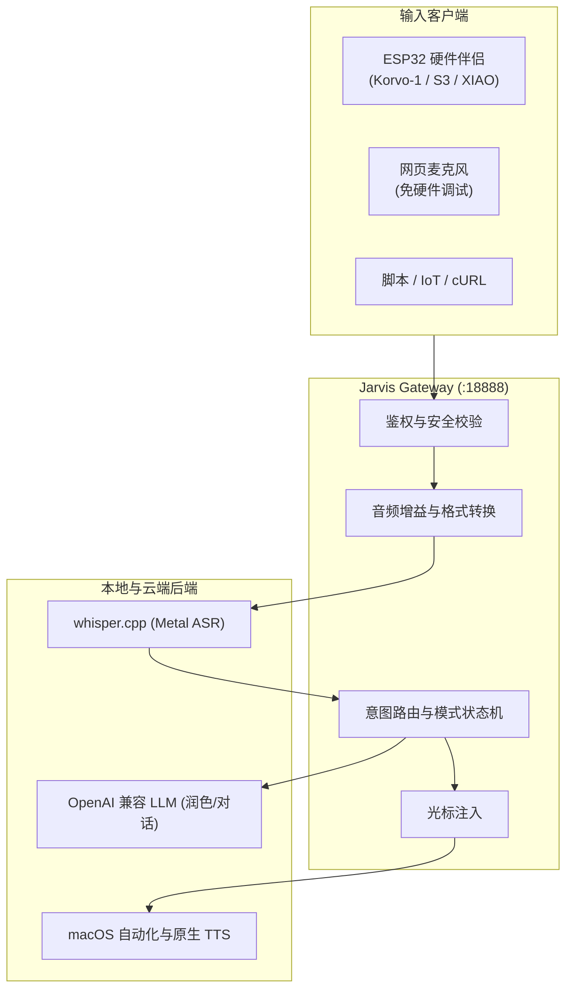

# Jarvis Gateway（桌面 AI 伴侣本地网关与控制台）

[](LICENSE)
[](pyproject.toml)
[]()
[](CONTRIBUTING.md)

[English](./README.md) | **简体中文**

把 Mac 变成各类硬件伴侣（ESP32、微型麦克风、树莓派等）的本地专属大脑：**离线语音转文字（Whisper Metal）、AI 智能润色、直接键入系统光标、语音控制 Mac**。音频全程留在本机与局域网内。

> 💡 **v2.3 亮点**
> - **内置网页虚拟麦克风**：没有 ESP32 也能直接打开控制台，按住空格说话，体验光标键入与 AI 润色。
> - **架构模块化**：拆分为 `audio` / `asr` / `tts` / `llm` / `actions` / `server` / `services` 标准包。
> - **安全默认值**：默认只监听 `127.0.0.1`，旧版 `:8080` 端口默认关闭，写接口支持可选 Bearer 鉴权、Host 校验与请求体上限。
> - **测试与 CI**：pytest 覆盖路由、安全、音频与命令白名单；GitHub Actions 自动跑 lint 与测试。

---

## 30 秒极速体验（无需硬件）

### 1. 克隆并安装

```bash
git clone https://github.com/peyoba/jarvis-gateway.git
cd jarvis-gateway
python3 -m venv venv
source venv/bin/activate
pip install -e .
```

### 2. 安装本地 Whisper（推荐 Apple Silicon）

```bash
brew install whisper.cpp
mkdir -p ~/.cache/whisper
curl -L -o ~/.cache/whisper/ggml-small-q5_1.bin \
  https://huggingface.co/ggerganov/whisper.cpp/resolve/main/ggml-small-q5_1.bin
```

### 3. 配置大模型

```bash
cp config.example.json config.json
```

填入任意 OpenAI 兼容服务的 `api_key` / `base_url` / `model`（OpenAI、DeepSeek、通义千问、本地 Ollama 等均可）。不想把密钥写进文件时，可用环境变量占位：

```json
"api_key": "${OPENAI_API_KEY}"
```

启动时会把 `${OPENAI_API_KEY}` 展开为环境变量值。

### 4. 一键启动

```bash
./jarvis start --open
```

浏览器自动打开 `http://127.0.0.1:18888/`。按住「按住说话」按钮（或空格键）对麦克风说话，松开后文字会打进当前聚焦的任意应用（VS Code、微信、Obsidian 等）光标中。

> 网页录音使用原始 16 kHz 单声道 PCM，而不是 WebM/Opus，因此与 ESP32 走完全相同的链路。

### 5. 可选：让板子或手机接入局域网

出于安全考虑，网关默认只监听 `127.0.0.1`，旧版 `:8080` 数据端口也默认关闭。需要硬件接入时：

```jsonc
// config.json
{
  "gateway": {
    "host": "0.0.0.0",
    "port": 18888,
    "auth_token": "${JARVIS_AUTH_TOKEN}",
    "allowed_hosts": ["jarvis.local"],
    "enable_legacy_data_port": false
  }
}
```

```bash
export JARVIS_AUTH_TOKEN="$(openssl rand -hex 24)"
./jarvis restart
```

`gateway.auth_token` 的 `${VAR}` 占位符在启动时从环境变量展开，密钥无需提交到仓库；如果引用的令牌变量缺失或为空，启动会失败，不会静默关闭鉴权。非空的 `JARVIS_AUTH_TOKEN` 环境变量会覆盖配置文件中的 `auth_token`；使用 launchd/Finder 时必须单独配置它的环境。令牌应使用不含空白的随机可见 ASCII 字符；非回环监听未配置令牌会拒绝启动。

开启后，客户端写请求与完整 `/status` 需带 `Authorization: Bearer <token>` 或 `X-Jarvis-Token: <token>`。**现有 ESP32 固件不会自动携带该请求头**，启用鉴权前请先更新固件。`/ping`、不含最近文本的 `/status?summary=1` 和 `/mode?simple=1` 保持开放供板子/App 做健康检查；完整 `/status` 因包含最近听写内容，配置令牌后需要鉴权。

模式切换使用 POST；旧 GET 写接口返回 405，仍使用旧接口的固件需要同步修改。并行音频请求返回 429，不再乱序上屏。网页单次录音最多 60 秒，上传请求体最多 8 MiB、解码后最多 120 秒。

---

## 架构总览



---

## 目录结构

```text
jarvis-gateway/
├── src/jarvis_gateway/          # 核心模块化代码库
│   ├── audio/                   # 音频格式转换与增益
│   ├── asr/                     # whisper-server 与 CLI 驱动
│   ├── tts/                     # macOS 原生 16 kHz 语音合成
│   ├── llm/                     # 双通道 OpenAI 兼容润色与对话
│   ├── actions/                 # 白名单系统控制与光标注入
│   ├── services/                # Token 统计与天气服务
│   ├── server/                  # 统一 HTTP 网关（18888）
│   └── web/                     # 暗色控制台（含网页录音）
├── tests/                       # pytest 测试套件
├── build/                       # macOS 菜单栏 App（Swift）
├── docs/                        # 控制台使用与协议文档
├── config.example.json          # 配置模板
├── pyproject.toml               # Python 构建与工具配置
└── jarvis                       # 启动 / 停止 / 自检 CLI
```

---

## 四种输入模式

| 模式 | 触发方式 | 行为 | 端到端耗时 |
|---|---|---|---|
| **智能分流 `auto`** | 默认 | 录音 < 阈值（默认 2.8s）原字直出；≥ 阈值调用 LLM 润色 | 通常 < 1.5s，视环境而定 |
| **极速原字 `raw`** | 控制台 / HTTP API | 听到什么打什么，不调用云端 | 通常 < 1s，视环境而定 |
| **AI 润色 `polish`** | 控制台 / HTTP API | 强制去除口癖、纠正同音字、规整标点 | ASR + LLM 耗时 |
| **智能问答 `dialog`** | 控制台 / HTTP API | 不打字，语音问答并执行系统动作 | 取决于 LLM |

也可以口语覆盖：「**原字：**…」「**润色：**…」「**贾维斯，**…」。

系统快捷指令（音量、音乐、锁屏、天气等）只在 `dialog` 模式或句首带唤醒词「贾维斯」时执行。打字模式不会劫持口述内容，例如「把音量调到五十」会原样上屏，而不是真的改音量。

---

## 硬件接入协议

任何能发 HTTP POST 的硬件均可接入：

- **音频上报**：`POST /chat?mode=auto`（或 `/type`）
- **请求体**：16 kHz / 16-bit / 单声道 PCM，或标准 RIFF WAV；请求体上限 8 MiB，解码后最长 120 秒
- **响应**：

```text
+--------------------------------+--------------------------------+
| 4 字节 Big-Endian JSON 长度    | JSON 元数据 (UTF-8)            |
+--------------------------------+--------------------------------+
| 16 kHz 16-bit 单声道 PCM 音频流（打字模式填充 100ms 静音帧）    |
+----------------------------------------------------------------+
```

其他接口：

- `GET /status`：控制台状态（配置令牌后需鉴权）
- `GET /ping`、`GET /mode?simple=1`：开放的心跳与模式查询
- `POST /mode?set=auto|raw|polish|dialog`：切换模式（也接受 JSON `{"mode": "..."}`）；GET 仅用于查询
- `POST /toggle-mode`：轮换模式
- `GET /token-stats`、`GET /weather`：Token 与天气数据（默认合并到 `18888`）

---

## 环境要求与权限

1. **macOS 辅助功能**：打字注入通过模拟 `Cmd+V` 完成。前往
   `系统设置 → 隐私与安全性 → 辅助功能`，勾选终端（`Terminal` / `iTerm`）或 `Jarvis.app`。
2. **麦克风权限**：首次使用网页录音时，浏览器会请求麦克风权限。
3. **网络边界**：默认只监听 `127.0.0.1`。绑定 `0.0.0.0` 时必须设置 `gateway.auth_token`，否则拒绝启动。局域网 HTTP 不加密；不要把端口直接暴露到公网，远程访问请用 VPN 或正确配置的带鉴权 TLS 代理。
4. **日志与隐私**：音频只经过临时文件处理，不落持久化路径。默认日志只记录字节数、耗时、状态和字数，不记录听写正文、模型回复或剪贴板内容；新启动器管理的服务日志使用 `0700` 目录、`0600` 文件，按 5 MiB 滚动并保留两份备份，不自动清除旧日志。仅在短时本机排障时设置 `JARVIS_HTTP_LOG`。普通 raw 听写不调用云模型；显式口述「润色：……」会覆盖 raw，polish/dialog 的文本会发送给配置的模型。

### Python 包与完整工程的区别

安装 wheel 后使用 `jarvis-gateway --config /path/to/config.json`，只启动网关；Whisper 服务需独立启动，或使用配置好的 CLI 回退。菜单栏 App 与 `./jarvis` 启动器依赖完整工程、macOS 和 Python 环境。安装或构建不会替换正在运行的旧服务。

---

## 测试

```bash
pip install -e ".[dev]"
pytest -q
ruff check src tests
```

测试覆盖音频转换、混合协议、命令白名单、HTTP 路由、鉴权、Host 校验、请求体上限与幻觉过滤。

---

## 开源协议

本项目采用 [MIT License](LICENSE)。
