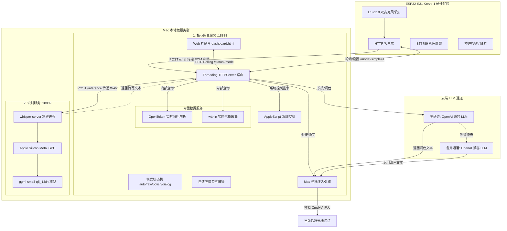
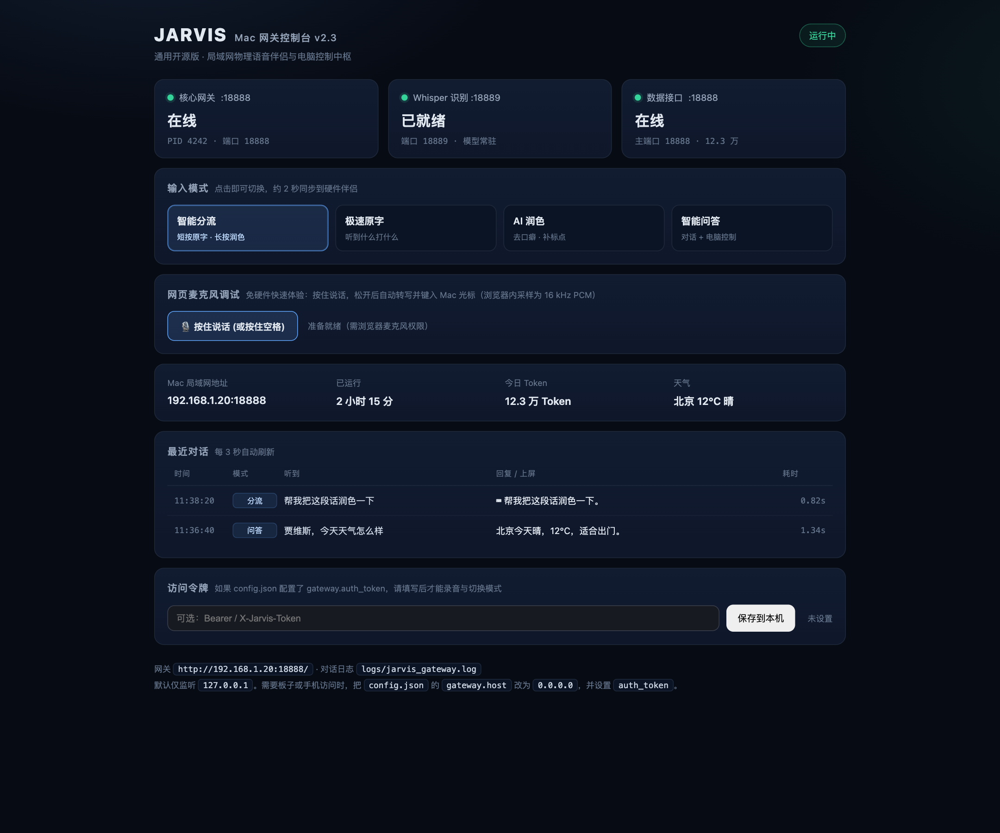
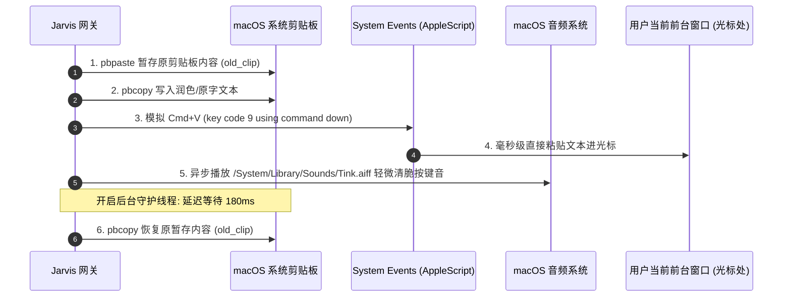
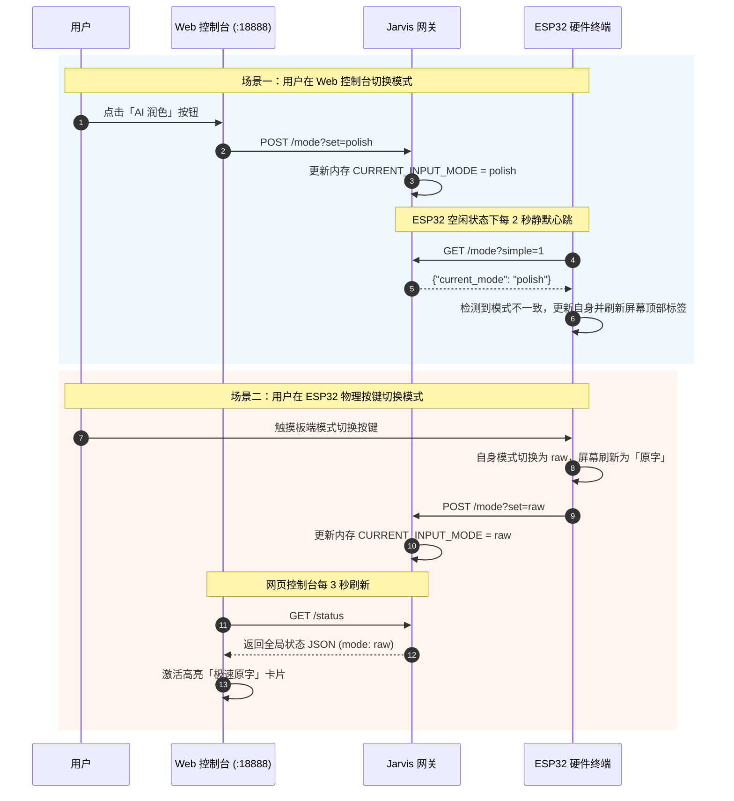
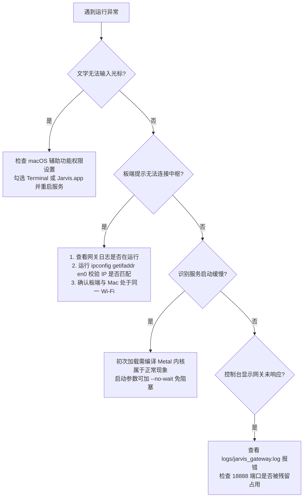

# JARVIS 服务器控制台与本地网关详尽技术手册

> **系统版本**：Jarvis Gateway v2.3 (macOS Native + ESP32 Reference Companion)  
> **文档定位**：全功能架构设计、控制台操作指南、通信协议规格与底层核心机制手册  
> **适用对象**：嵌入式硬件开发者、Mac 本地 AI 开发者、系统运维与高级用户

---

## 目录
1. [系统定位与设计哲学](#1-系统定位与设计哲学)
2. [总体系统架构与拓扑拆解](#2-总体系统架构与拓扑拆解)
3. [控制台四大操控形态全景](#3-控制台四大操控形态全景)
   - [3.1 Web 浏览器控制台 (dashboard.html)](#31-web-浏览器控制台-dashboardhtml)
   - [3.2 macOS 原生菜单栏 App (Jarvis.app)](#32-macos-原生菜单栏-app-jarvisapp)
   - [3.3 CLI 运维命令中心 (./jarvis)](#33-cli-运维命令中心-jarvis)
   - [3.4 桌面一键便捷脚本 (.command)](#34-桌面一键便捷脚本-command)
4. [核心引擎与关键技术机制](#4-核心引擎与关键技术机制)
   - [4.1 音频流水线与自适应增益算法](#41-音频流水线与自适应增益算法)
   - [4.2 Whisper-Server Metal GPU 极速转写引擎](#42-whisper-server-metal-gpu-极速转写引擎)
   - [4.3 Mac 光标毫秒级打字注入与原子剪贴板保护](#43-mac-光标毫秒级打字注入与原子剪贴板保护)
   - [4.4 AI 智能润色引擎与双通道容灾](#44-ai-智能润色引擎与双通道容灾)
   - [4.5 本地即时指令拦截与 Mac 自动化控制](#45-本地即时指令拦截与-mac-自动化控制)
   - [4.6 软硬件双向模式无缝同步机制](#46-软硬件双向模式无缝同步机制)
5. [网络通信与二进制协议规格 (Wire Protocol)](#5-网络通信与二进制协议规格-wire-protocol)
   - [5.1 API 接口清单](#51-api-接口清单)
   - [5.2 混合二进制回包协议规范](#52-混合二进制回包协议规范)
6. [配置文件详尽解析 (config.json)](#6-配置文件详尽解析-configjson)
7. [系统部署、权限配置与环境自检](#7-系统部署权限配置与环境自检)
8. [故障排查速查矩阵 (Troubleshooting)](#8-故障排查速查矩阵-troubleshooting)

---

## 1. 系统定位与设计哲学

**JARVIS Gateway** 最初为 **ESP32-S31-Korvo-1** 语音输入伴侣设计，现已泛化为 **Mac 本地智能神经中枢**。它将用户的 Mac 转化为硬件终端的专属大脑，提供**离线极速语音识别（ASR）**、**AI 智能口语润色**、**Mac 光标直接打字键入**以及**自然语言语音控制 Mac 系统**的能力。

```
┌─────────────────────────┐          Wi-Fi (局域网 HTTP)         ┌─────────────────────────┐
│   ESP32-S31 硬件伴侣    │ ───────────────────────────────────► │      Mac 本地中枢       │
│                         │                                      │                         │
│ • 双麦克风阵列录音      │ ◄─────────────────────────────────── │ • Whisper Metal 离线识别│
│ • 物理按键与触控        │      混合二进制回包 (JSON + PCM)       │ • AI 大模型口语润色     │
│ • ST7789 彩屏状态显示   │                                      │ • 光标直接打字/控制 Mac │
└─────────────────────────┘                                      └────────────┬────────────┘
                                                                              │
                                                                 ┌────────────┴────────────┐
                                                                 │   JARVIS 服务器控制台   │
                                                                 │                         │
                                                                 │ • Web 控制台 (:18888)   │
                                                                 │ • 菜单栏 App (Jarvis.app│
                                                                 │ • 终端 CLI 工具 (jarvis)│
                                                                 └─────────────────────────┘
```

### 核心设计哲学
1. **音频不出局域网（Privacy First）**：ESP32 录音仅通过局域网直接传输到本机的 Whisper-Server，音频原数据不上传任何第三方云端。
2. **零感知打字注入（Zero Disruption）**：打字通过 macOS 底层模拟直接敲入当前光标焦点，毫秒级注入且**自动备份并无缝恢复用户原有剪贴板**，绝不破坏用户原有的复制粘贴状态。
3. **极速与智能分流（Speed & Intelligence Balance）**：独创「长短按自动分流」与「物理/网页双向同步」，短按原字即刻出，长按大模型润色，满足全场景文字录入需要。
4. **全链路容灾降级（Fail-Safe Redundancy）**：主模型异常自动切换备用模型；模型通道若全部超时，自动安全回退为原字上屏，确保打字流程永不卡死。

---

## 2. 总体系统架构与拓扑拆解

JARVIS 服务器控制台采用**两端（ESP32 板端 + Mac 端）、两个常驻进程（网关 + 识别）、可选云端 LLM 双通道**的本地优先架构：



### 两个常驻进程与内置数据服务

| 组件 | 监听端口 | 绑定地址 | 承载技术 | 核心功能 |
|---|---|---|---|---|
| **核心网关 (Gateway)** | `18888` | `127.0.0.1`（可配） | Python `ThreadingHTTPServer` | 音频自适应放大、意图路由、模式分流、光标打字、AppleScript 动作、TTS 生成，并内置 Token/天气轮询与 Web 控制台 |
| **识别服务 (Whisper)** | `18889` | `127.0.0.1` | `whisper-server` (C++ Metal) | 模型（`ggml-small-q5_1`）常驻内存/显存，仅监听本机回环；转写耗时取决于音频长度与硬件 |
| **兼容数据端口（可选）** | `8080`（默认关闭） | 与网关同地址 | 复用网关 HTTP handler | 仅当 `gateway.enable_legacy_data_port` 为 `true` 时额外监听；未开启时 Token/天气接口直接在主端口提供 |

---

## 3. 控制台四大操控形态全景

JARVIS 为用户提供了从**现代化 Web 页面**、**macOS 沉浸式原生菜单栏**、**专业 CLI 终端**到**桌面一键脚本**的完整操作生态：

```
                ┌───────────────────────────────────────────────┐
                │          JARVIS 用户控制接入矩阵              │
                └──────┬───────────────┬──────────────┬─────────┘
                       │               │              │
      ┌────────────────┴────────┐      │      ┌───────┴───────────────┐
      │ 1. 现代化 Web 控制台    │      │      │ 3. CLI 终端中心       │
      │   http://127.0.0.1:18888│      │      │   ./jarvis <command>  │
      └─────────────────────────┘      │      └───────────────────────┘
                                       │
                      ┌────────────────┴────────────────┐
                      │ 2. macOS 原生菜单栏 App         │
                      │   Jarvis.app (常驻 Status Item) │
                      └────────────────┬────────────────┘
                                       │
                      ┌────────────────┴────────────────┐
                      │ 4. 桌面快速动作脚本             │
                      │   *.command                     │
                      └─────────────────────────────────┘
```

---

### 3.1 Web 浏览器控制台 (`dashboard.html`)

打开方式：浏览器访问 `http://127.0.0.1:18888/`。默认只监听本机；如需让同一局域网的板子或手机访问，请把 `config.json` 中的 `gateway.host` 改为 `0.0.0.0`，并配置 `gateway.auth_token`（详见 README 的「局域网与鉴权」）。



#### 核心功能区域布局
1. **顶部状态药丸 (Health Pill)**：
   - 动态显示「运行中」或「网关未响应」。
   - 当网关正常响应 `/status` 时，显示翠绿发光态；断开时变红并提示排查信息。
2. **三核心服务健康卡片 (Service Health Cards)**：
   - **核心网关 :18888**：显示在线状态、当前网关 PID、端口号。
   - **Whisper 识别 :18889**：实时探测 18889 端口存活态。若在预热显示「正在预热」，就绪后显示「已就绪 · 模型常驻」。
   - **数据接口**：显示 Token/天气数据服务的状态与当前实际端口。该服务内置于网关进程；默认显示主端口 `18888`，仅当 `enable_legacy_data_port` 为 `true` 且 `:8080` 绑定成功时才显示兼容端口。
3. **输入模式交互面板 (Interactive Mode Switcher)**：
   - 提供 4 个模式卡片按键：
     - **智能分流 (`auto`)**：短按（<2.8秒）原字打字，长按（≥2.8秒）AI 智能润色。
     - **极速原字 (`raw`)**：听到什么敲什么，跳过大模型，延迟通常低于 1 秒（取决于音频长度与机器）。
     - **AI 润色 (`polish`)**：无论时长，全部经由大模型剔除口癖、整理标点与格式。
     - **智能问答 (`dialog`)**：不打字，Jarvis 进行语言交互与 Mac 动作控制，语音回传播报。
   - 交互特性：在网页上点击任意模式，控制台即刻发送 `POST /mode?set=<mode>`，网关瞬时更新内存状态；板端每 2 秒静默拉取一次同步，彩屏模式标签 2 秒内对齐。
4. **关键系统指标四宫格 (System Metrics Grid)**：
   - **Mac 局域网地址**：智能识别 `en0`/`en1` 网卡真实 IP，排除虚拟网卡和 VPN 代理干扰（如 `192.168.1.20:18888`），方便板端配置连接。
   - **已运行时间**：格式化显示天、小时、分、秒。
   - **今日 Token**：直观展示当日模型消耗（如 `12.3万 Token`，仅作界面示例）。
   - **天气状况**：展示实时城市气温与天气描述（如 `北京 12°C 晴`）。
5. **最近对话瀑布流面板 (Recent Turns Table)**：
   - 每 3 秒自动轮询网关 `/status`。
   - 展示最近 12 轮交互明细：
     - **时间**：精确到秒（`HH:mm:ss`）。
     - **模式**：分流、原字、润色、问答（彩色微章）。
     - **听到内容**：Whisper 识别出的原始口述语句。
     - **回复/上屏**：打字模式下带有 `⌨` 前缀并显示实际注入内容；问答模式显示 Jarvis 的回复。
     - **耗时**：端到端单轮处理总耗时（如 `0.68s`）。
     - **异常态高亮**：若命中静音/幻觉过滤，行标黄色显示 `miss`；若发生网络或解析错误，行标红色显示 `error`。

---

### 3.2 macOS 原生菜单栏 App (`Jarvis.app`)

工程源码位于 `build/main.swift`，基于 Swift 与 Cocoa 框架编写，免除终端黑框的困扰，以原生姿态融入 macOS 体验。

```
[菜单栏声波图标 ∿]
   │
   ├── ● 网关运行中 (端口: 18888  ASR: 就绪)
   ├── 模式 auto · 今日 12.3万 Token
   ├── ──────────────────────────────────
   ├── 启动服务
   ├── 停止服务
   ├── 重启服务
   ├── ──────────────────────────────────
   ├── 打开控制台             (⌘O)
   ├── 打开日志目录
   ├── 打开辅助功能设置       (打字排障直达)
   ├── ──────────────────────────────────
   ├── 登录时自动启动服务     (✓ 写入 LaunchAgent)
   ├── 打开 App 时自动拉起服务(✓ 默认开启)
   ├── ──────────────────────────────────
   ├── 退出 (服务继续运行)
   └── 退出并停止服务
```

#### 关键技术亮点
1. **轻量无感知 (`LSUIElement = true`)**：
   - App 不会在 macOS Dock（程序坞）生成图标，只驻留于顶部菜单栏，不占用前台窗口资源。
2. **状态感知动态图标**：
   - 服务正常启动后显示系统 SF Symbol `waveform`（动态声波）；
   - 服务未运行或离线时显示 `waveform.slash`；
   - 悬停 Tooltip 动态展示服务简报。
3. **防抖与自动化拉起**：
   - 首次启动 App 时，若勾选「打开 App 时自动拉起服务」，后台将异步调用 `./jarvis start --no-wait`，无需等待转写模型即可完成 UI 渲染，避免菜单栏卡死。
4. **单实例重击打开（Re-open Event）**：
   - 已经处于运行态时，再次双击 `Jarvis.app`，系统不会报错，而是触发 `applicationShouldHandleReopen` 自动在默认浏览器中弹出 Web 控制台。
5. **项目目录动态定位机制**：
   - `resolveProjectRoot()`：App 优先查找同级目录下的 `jarvis` 启动脚本；如果用户将 `Jarvis.app` 复制或移动到 `/Applications` 或桌面，App 会回退读取编译打包时注入的 `JarvisProjectRoot` 绝对路径，确保核心功能始终可用。

---

### 3.3 CLI 运维命令中心 (`./jarvis`)

对于工程师与自动化运维场景，网关根目录提供了纯 Python 编写（无需激活 venv 即可直接执行）的统一脚手架：

```bash
cd /path/to/jarvis-gateway
./jarvis <command> [options]
```

#### CLI 命令总览手册

| 命令 | 完整调用 | 参数选项 | 说明 |
|---|---|---|---|
| **启动** | `./jarvis start` | `--open`：启动并弹出浏览器控制台<br>`--no-wait`：不等待 Whisper 模型预热完成 | 依次拉起 Whisper 与核心网关（数据服务内置于网关），保存 PID |
| **停止** | `./jarvis stop` | 无 | 安全向网关与 Whisper 发送 `SIGTERM`，超时自动降级 `SIGKILL` |
| **重启** | `./jarvis restart` | `--open`：重启后打开控制台 | 释放端口并重启全部服务 |
| **查看状态** | `./jarvis status` | 无 | 打印彩色终端状态卡片、服务 PID、模式、今日 Token |
| **打开控制台** | `./jarvis open` | 无 | 触发 macOS `open http://127.0.0.1:18888/` |
| **跟踪日志** | `./jarvis logs` | `gateway`、`whisper`、`data`（`data` 现与 `gateway` 同日志）<br>`-f, --follow`：实时跟踪输出 | 快速调用 `tail -n 100 -f` 追踪指定服务日志 |
| **自启动管理**| `./jarvis autostart`| `on`：安装并加载登录启动项<br>`off`：卸载启动项<br>`status`：查看状态 | 操作 `~/Library/LaunchAgents/ai.jarvis.gateway.plist` |
| **环境自检** | `./jarvis doctor` | 无 | 全面检查 Python 虚拟环境、Whisper 模型、系统权限等 |

#### 进程守卫与端口冲突保护机制 (`stop_port`)
- 网关采用 PID 探测与 `lsof -nP -ti tcp:<port>` 结合双重确认机制。
- 执行 `stop` 或 `start` 时，会通过 `ps -p <pid> -o command=` 验证端口占有者的进程标识。只有包含 `jarvis`、`whisper`、`token_usage` 的进程才会被安全释放，严禁误杀宿主机其他软件所占用的端口。

---

### 3.4 桌面一键便捷脚本 (`.command`)

Jarvis-Gateway 根目录内置 7 个双击即用的 macOS `.command` 批处理文件：
- `启动 Jarvis.command`：拉起后台服务并自动在默认浏览器中开启控制台。
- `停止 Jarvis.command`：安全停止网关与 Whisper 进程并释放端口。
- `状态面板.command`：在终端展示彩色运行简报并打开控制台。
- `查看日志.command`：自动在新终端窗口中以 `tail -f` 跟踪核心网关日志。
- `环境自检.command`：运行 `jarvis doctor` 帮助新手定位缺失模型或依赖。
- `开启开机自启.command` / `关闭开机自启.command`：免敲命令行开关系统登录项。

---

## 4. 核心引擎与关键技术机制

### 4.1 音频流水线与自适应增益算法

物理设备麦克风由于距离远近或用户低语，录音电平可能忽大忽小，导致 ASR 丢字或吞字。Jarvis 网关在进入 ASR 前引入了**无损音频自适应电平增益算法 (`apply_adaptive_gain`)**：

```python
# 算法核心片段逻辑
a = array.array('h')
a.frombytes(pcm_data)
max_val = max(abs(x) for x in a)

# 若说话声音偏轻（峰值低于 14000），将目标动态拉升至 22000，最大允许放大 2.8 倍
if 0 < max_val < 14000:
    factor = min(2.8, 22000.0 / max_val)
    for i in range(len(a)):
        val = int(a[i] * factor)
        a[i] = max(-32767, min(32767, val)) # 软限幅防止爆音
```

该算法只在峰值偏低时启用，采用 Python 原地循环完成，通常为毫秒级开销；可改善小声/远场录音的电平，但识别准确率仍取决于环境噪声与模型。

---

### 4.2 Whisper-Server Metal GPU 极速转写引擎

Jarvis 网关抛弃了每次调用都要重新加载模型、重新初始化 Metal 内核的冷启动 CLI 方案，采用常驻内存的 **`whisper-server`（基于 whisper.cpp）**：
- **常驻架构**：监听 `127.0.0.1:18889`，启动时加载一次 `ggml-small-q5_1.bin` 模型后常驻内存。
- **Metal 硬件加速**：充分榨干 Apple Silicon (M1/M2/M3/M4) 统一内存与 GPU 算力。
- **Prompt 引导与抑制漂移**：注入 Prompt `"以下是普通话简体中文语音输入。"`，显著减少开源 Whisper 常见的繁体化、中文误判为英文与无声音频幻觉。
- **动态降级**：若检测到 `whisper-server` HTTP 接口未响应，网关会自动无感降级调用本地 `whisper-cli` 进程补位转写。

---

### 4.3 Mac 光标毫秒级打字注入与原子剪贴板保护

Jarvis 网关最震撼的体验是**语音直接敲入当前光标焦点**。然而直接使用按键模拟往往存在丢字、中文字符截断和打断用户原有剪贴板的严重缺陷。

Jarvis 采用了独创的 **原子级剪贴板暂存 -> Cmd+V 注入 -> 延迟异步恢复** 架构：



#### 工程优势
- **整段上屏**：无需逐字符模拟按键，整段文本通过一次粘贴写入当前输入框；实际耗时取决于目标应用。
- **原剪贴板零污染**：用户刚才复制的一长串代码或图片，在语音输入完成后依然完好保存在剪贴板中。
- **听觉确认反馈**：注入瞬间触发轻微清脆的 `Tink` 音效，让用户在不看屏幕的情况下盲打也能获得确切的正向反馈。

---

### 4.4 AI 智能润色引擎与双通道容灾

针对口语化表达中的口吃、重复、语气助词及标点混乱问题，网关内置了极速大模型润色机制：
- **精准 System Prompt**：剔除“呃”、“那个”、“然后”等语气词；纠正同音别字；格式化 Markdown 序号；严禁篡改原意与增加事实。
- **主备通道多级容灾**：
  - **主通道**：任意 OpenAI 兼容模型（默认 8s 超时）。
  - **备用通道**：任意 OpenAI 兼容服务（设定 8s 超时）。
  - **安全降级**：若两通道皆不可达，立即回退为 **Whisper 识别的原字直接敲入光标**，杜绝进程阻塞或文字丢失。

---

### 4.5 本地即时指令拦截与 Mac 自动化控制

用户口述内容进入大模型之前，网关会先通过正则与关键词树执行**本地指令即时拦截（`plan_fast_command`）**：

| 控制意图 | 语音口令示例 | 触发动作与实现原理 |
|---|---|---|
| **Token 查询** | “今天消耗了多少Token” / “查一下统计” | 读取网关内置的 OpenToken 或本地估算数据，播报今日累计用量 |
| **天气查询** | “今天天气怎么样” / “外面下雨吗” | 毫秒级读取网关内置气象缓存，播报：“北京当前气温 12度，天气状况 晴。” |
| **时间查询** | “现在几点” / “今天周几” | 读取 Mac 本地时钟，播报：“现在是 14点20分，星期二。” |
| **音量调节** | “静音” / “声音大一点” / “音量调到60” | `osascript -e "set volume output volume 60"` |
| **音乐控制** | “放歌” / “暂停播放” / “切歌/下一首” | `osascript -e 'tell application "Music" to play/pause/next track'` |
| **屏幕锁定** | “锁屏” / “锁定电脑” | `osascript` 模拟 Control+Command+Q（`CGSession` 已在新版 macOS 移除） |

若语音命中上述命令，网关将**直接执行系统动作并通过 TTS 合成音频回传硬件播报**，完全不消耗任何云端 Token，实现纯本地秒级控制。

---

### 4.6 软硬件双向模式无缝同步机制

模式的更改可能源于两端：用户可能在网页控制台上点击，也可能在 ESP32 板子上按下切换按键。系统通过**轻量 HTTP 轮询**实现双向同步（无 WebSocket，也无需长连接）：



---

## 5. 网络通信与二进制协议规格 (Wire Protocol)

### 5.1 API 接口清单

#### 网关主服务端口：`18888`
- `GET /` 或 `GET /dashboard`：返回控制台 HTML 界面。
- `GET /status`：返回控制台专用的全量 JSON 状态快照（每次请求实时汇总，Web 端每 3 秒轮询）。快照含最近听写文本，因此配置 `gateway.auth_token` 后该接口也需鉴权；`GET /status?summary=1` 只返回网关/Whisper/数据摘要与统计，不含最近文本，供 CLI/App 健康检查；`/ping` 与 `/mode?simple=1` 保持开放。
- `GET /ping`：轻量心跳监测，返回服务就绪态与版本；本机回环请求还会带上工程根目录 `root`，供启动器识别重复实例（不会向局域网暴露路径）。
- `GET /mode`：查询当前模式；`?simple=1` 时仅返回 `{"current_mode": "..."}`（板端轮询用）。
- `POST /mode?set=<auto|raw|polish|dialog>`：设置模式，也接受 JSON `{"mode": "..."}`。状态查询使用 `GET /mode?simple=1`；GET 写操作已禁用并返回 405。
- `POST /toggle-mode`：依次轮换模式（`auto -> raw -> polish -> dialog -> auto`）。
- `POST /chat` 或 `POST /type`：ESP32 录音上报通道，16 kHz / 16-bit / 单声道 PCM 或 WAV；请求体上限 8 MiB，解码后最长 120 秒。
- `GET /token-stats`：OpenToken 今日汇总、各工具明细。
- `GET /weather`：当前气温、天气描述、湿度与城市中文标签。
- 旧版独立 `:8080` 仅在 `gateway.enable_legacy_data_port` 为 `true` 时监听，并复用上述数据路径。

#### 鉴权（可选，共享局域网建议开启）
`gateway.auth_token` 非空时，所有写操作必须带 `Authorization: Bearer <token>` 或 `X-Jarvis-Token: <token>`，并且浏览器写请求的 `Origin` 必须与当前 Host 同源；无 Origin 的 ESP32/CLI 请求仍可用令牌访问。环境变量 `JARVIS_AUTH_TOKEN` 优先，缺失的 `${VAR}` 会阻止启动。ESP32 固件当前不会自动携带 token，启用前请先更新固件。

---

### 5.2 混合二进制回包协议规范

为了在单次 HTTP 响应中同时将**结构化文字元数据（用于板端屏幕渲染）**与**原始语音 PCM 流（用于板端扬声器流式播放）**回传给 ESP32，Jarvis 网关定义了高效的**前置定长包头二进制混合协议**：

```
 0                   1                   2                   3
 0 1 2 3 4 5 6 7 8 9 0 1 2 3 4 5 6 7 8 9 0 1 2 3 4 5 6 7 8 9 0 1
+-+-+-+-+-+-+-+-+-+-+-+-+-+-+-+-+-+-+-+-+-+-+-+-+-+-+-+-+-+-+-+-+
|                 JSON 载荷长度 (4 字节, Big-Endian)            |
+-+-+-+-+-+-+-+-+-+-+-+-+-+-+-+-+-+-+-+-+-+-+-+-+-+-+-+-+-+-+-+-+
|                                                               |
+                      UTF-8 编码 JSON 元数据                   +
|       {"heard":"...", "reply":"...", "typed":"...",              |
|        "mode":"...", "kind":"ok|miss|error", "error":"..."}      |
+-+-+-+-+-+-+-+-+-+-+-+-+-+-+-+-+-+-+-+-+-+-+-+-+-+-+-+-+-+-+-+-+
|                                                               |
+                   16kHz 16-bit Mono PCM 音频流                +
|               (直接灌入 I2S DMA 硬件缓冲区播放)               |
+-+-+-+-+-+-+-+-+-+-+-+-+-+-+-+-+-+-+-+-+-+-+-+-+-+-+-+-+-+-+-+-+
```

#### 打字模式下的静音优化
当系统判定当前操作为「打字输入」且未开启 `speak_typed` 时，网关**不发送冗长的播报语音，而是发送精确的 3200 字节（对应 100ms）静音 PCM 帧**。板端收到这 100ms 静音数据后立即顺畅退出播放状态并归位为 IDLE，既不打扰办公，又彻底避免了硬件状态机挂起的问题。

---

## 6. 配置文件详尽解析 (`config.json`)

系统配置文件位于工程根目录下的 `config.json`，在启动时与系统内置默认值进行深度递归合并（`deep_merge`）：

```json
{
  "gateway": {
    "host": "127.0.0.1",
    "port": 18888,
    "auth_token": "",
    "allowed_hosts": [],
    "enable_legacy_data_port": false
  },
  "whisper": {
    "cli_bin": "/opt/homebrew/bin/whisper-cli",
    "server_bin": "/opt/homebrew/bin/whisper-server",
    "model": "~/.cache/whisper/ggml-small-q5_1.bin",
    "port": 18889,
    "language": "zh",
    "prompt": "以下是普通话简体中文语音输入。",
    "beam_size": 2
  },
  "tts": {"voice": "Tingting", "gain": 1.3},
  "typing": {
    "polish_threshold_sec": 2.8,
    "speak_typed": false,
    "default_mode": "auto"
  },
  "llm": {
    "primary": {
      "name": "主模型",
      "api_key": "YOUR_API_KEY_HERE",
      "base_url": "https://api.openai.com/v1",
      "model": "gpt-4o-mini",
      "timeout": 8.0
    },
    "fallback": {
      "name": "备用模型",
      "api_key": "",
      "base_url": "",
      "model": "",
      "timeout": 8.0
    }
  },
  "data_service": {
    "port": 8080,
    "opentoken_bin": "opentoken",
    "weather_city": "Beijing",
    "weather_label": "北京"
  }
}
```

> `api_key` 支持 `${ENV_NAME}` 占位符，启动时从环境变量展开；这样密钥不必写进 `config.json`。

### 关键参数说明表

| 节点 | 字段 | 类型 | 说明与推荐值 |
|---|---|---|---|
| `gateway` | `host` | String | 监听地址；默认 `127.0.0.1` 仅本机，供板子访问时改为 `0.0.0.0` |
| `gateway` | `auth_token` | String | 可选访问令牌；非空时写接口需 Bearer 头 |
| `gateway` | `allowed_hosts` | Array | 额外允许的 Host 头（如 `jarvis.local`），抵御 DNS rebinding |
| `gateway` | `enable_legacy_data_port` | Bool | 是否额外监听旧版 `:8080` 兼容端口，默认 `false`；数据接口始终在主端口可用 |
| `whisper` | `model` | String | 本地 ggml 模型路径，推荐 `ggml-small-q5_1.bin`（速度与精度的平衡点） |
| `whisper` | `beam_size` | Int | 集束搜索宽度，推荐 `2`（增大提高准确度但略微增加延迟） |
| `tts` | `voice` | String | macOS 系统合成音色名，中文推荐 `Tingting`（可用 `say -v '?'` 查询） |
| `typing` | `polish_threshold_sec`| Float | 自动分流长短按分界秒数，推荐 `2.8` |
| `typing` | `speak_typed` | Bool | 打字时是否朗读打字内容，默认 `false`（保持安静盲打） |
| `llm.primary` | `timeout` | Float | 主通道超时熔断时间，默认 `8.0` 秒 |
| `llm.fallback` | `timeout` | Float | 备用通道超时熔断时间，默认 `8.0` 秒 |

---

## 7. 系统部署、权限配置与环境自检

### 7.1 基础环境依赖安装
```bash
# 1. 安装 whisper.cpp 底层套件 (Homebrew)
brew install whisper.cpp

# 2. 准备 Python 虚拟环境与依赖
cd /path/to/jarvis-gateway
python3 -m venv venv
./venv/bin/pip install -e .
```

### 7.2 macOS 辅助功能权限（极其重要）
Mac 的光标模拟注入依赖 macOS Accessibility（辅助功能）授权。若未授权，语音能识别，但文字无法键入到光标处：
1. 打开 **系统设置 → 隐私与安全性 → 辅助功能**。
2. 确保勾选了以下对应运行环境：
   - 使用 **`Jarvis.app`** 启动时：勾选 **Jarvis.app**；
   - 使用 **终端 / .command** 启动时：勾选 **终端 (Terminal)** 或 **iTerm**。

### 7.3 环境自检 (`./jarvis doctor`)
运行环境自检命令，系统将自动核查 10 项核心依赖：
```text
Jarvis 环境自检
----------------------------------------------------------
  ✓ Python venv     /path/to/jarvis-gateway/venv/bin/python
  ✓ 网关脚本        app/jarvis_gateway.py
  ✓ 控制台页面      src/jarvis_gateway/web/dashboard.html
  ✓ 配置文件        config.json
  ✓ whisper-server  /opt/homebrew/bin/whisper-server
  ✓ Whisper 模型    ~/.cache/whisper/ggml-small-q5_1.bin
  ✓ opentoken (可选) opentoken
  ✓ 主模型配置      主模型
  ✓ say 命令        /usr/bin/say
  ✓ osascript       /usr/bin/osascript
----------------------------------------------------------
全部通过
```

---

## 8. 故障排查速查矩阵 (Troubleshooting)



| 故障现象 | 根因定位 | 快速解决步骤 |
|---|---|---|
| **板子说话没反应，提示连接超时** | Mac IP 发生漂移，或位于不同 Wi-Fi 频段 | 在 Mac 运行 `ipconfig getifaddr en0` 查询当前 IP，在板端设置中同步修改；若开着 VPN/代理，请确认未拦截局域网流量。 |
| **识别出来字了，但光标处没有打出字** | 缺失 macOS 辅助功能注入权限 | 打开菜单栏 App →「打开辅助功能设置」，勾选 `Jarvis.app` 以及当前使用的终端程序，完成后重启网关服务。 |
| **转写出现大量繁体中文或无关幻觉** | Whisper 模型在无声音频片段的自然幻觉 | 网关已内置 `is_hallucination` 过滤词库；若特定生僻词依然出现，可在 `src/jarvis_gateway/asr/manager.py` 的 `_HALLUCINATION_PHRASES` 中追加。 |
| **换电脑或移动目录后无法运行** | 虚拟环境 Python 符号链接失效 | 删除 `venv/` 目录，重新执行 `python3 -m venv venv && ./venv/bin/pip install -e .`。 |
| **公共网络安全防范** | 绑定 `0.0.0.0` 且未设 `auth_token` 时，同网段设备可访问控制台并提交音频 | 默认已只监听 `127.0.0.1`；确需局域网访问时设置 `auth_token`，在咖啡厅/机场等网络用完即执行 `./jarvis stop`。 |

---
> 维护者备忘：若修改了 `build/main.swift` 中的菜单逻辑，需在根目录下重新运行 `./build_app.sh` 重新编译 `Jarvis.app`；若只修改 Python 网关脚本或 HTML 控制台页面，仅需 `./jarvis restart` 重启服务即可即时生效。
